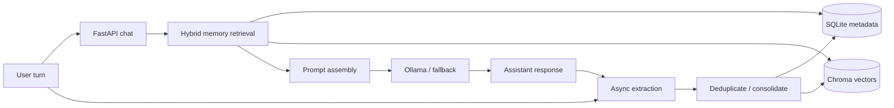

# Mendaly AI

Local-first conversational memory with hybrid SQLite and Chroma retrieval.

## Quick start

Requirements: Python 3.11+, Node 20+, and (optionally) Ollama. From the repository root:

```powershell
python -m venv .venv
.\.venv\Scripts\Activate.ps1
pip install -r requirements.txt
uvicorn app.main:app --reload
```

The API starts on http://localhost:8000. Then in `frontend/`, run `npm install` and `npm run dev`. Set `VITE_API_URL` to override the API URL. Ollama defaults to `llama3.2`; if it is unavailable, a deterministic local response and rule-based memory extraction keep the demo usable. Sentence Transformers and Chroma are optional; deterministic feature-hash embeddings and SQLite-only retrieval provide a lightweight fallback.

If Python is unavailable but Node.js 20+ is installed, run `node runtime/server.mjs` as a zero-dependency browser demo. It provides the chat, cross-session memory, settings, audit panel, sample seeder, and export tools using a local JSON store at `runtime/mendaly-runtime.json`. It reports that it is using the demo store; it does not run the FastAPI/SQLite/Chroma stack.

Set `OLLAMA_MODEL`, `OLLAMA_BASE_URL`, `DATABASE_URL`, `CHROMA_PATH`, and `EMBEDDING_MODEL` as needed. API documentation is at `/docs`.

On Windows, `./start.ps1` installs the Python dependencies and frontend packages, then launches both local servers in hidden windows. On macOS/Linux, `./start.sh` does the same. To run the backend checks, use `python -m pytest tests -q` from the repository root.

## Architecture



```text
Memory extraction: user + assistant + recent turns -> Ollama JSON (or rules) -> validate -> score -> upsert -> audit
Hybrid storage: normalized text -> embedding -> SQLite memory row + Chroma vector (SQLite remains authoritative)
Cross-session RAG: query -> vector candidates + SQLite fallback -> relevance/importance/recency ranking -> prompt -> response
```

Scoring is `0.60*cosine + 0.25*importance + 0.15*exp(-0.01*hours_since_access)`. Retrieval threshold defaults to 0.35. Similarity >=.88 reinforces; .72-.88 only supersedes when category/subject align; lower similarity inserts. Confidence and importance are clamped to [0,1].

## API

- `POST /api/v1/sessions`, `GET /api/v1/sessions`
- `GET /api/v1/sessions/{id}/messages`
- `POST /api/v1/chat` with `{session_id, message}`
- `GET /api/v1/memories?category=preference`, `DELETE /api/v1/memories/{id}`
- `GET /api/v1/health`
- `GET/PATCH /api/v1/settings`, `GET /api/v1/audit-logs`
- `POST /api/v1/memories`, `PUT/DELETE /api/v1/memories/{id}`
- `POST /api/v1/admin/seed-demo`, `POST /api/v1/admin/reset-db`, `GET /api/v1/admin/export-db`
- `POST /api/v1/voice/transcribe`, `POST /api/v1/voice/synthesize` (pluggable adapters; disabled until configured)

## Demo checklist

1. Create a conversation and share a name, stack, dietary preference, and project deadline.
2. Inspect extracted facts in the memory panel.
3. Start a new conversation and ask: “What should I order for dinner while I work on my backend tonight?”
4. Show that retrieved preference and project context inform the answer without earlier chat history.

## Security and scope

The app is designed for local use. Bind to localhost; do not expose it to a network without adding authentication, authorization, rate limits, and deployment hardening. Voice features are adapter interfaces only. Voice-clone registration is intentionally not implemented; any future registration must validate explicit consent and retain a consent phrase hash. Do not present HIPAA/SOC2 compliance or market-size estimates as verified claims.

## YC application notes

Draft answers and video scripts are in `docs/YC_APPLICATION.md`. Personal claims use explicit placeholders. Replace them with verified details, and validate traction and market claims before submission.
